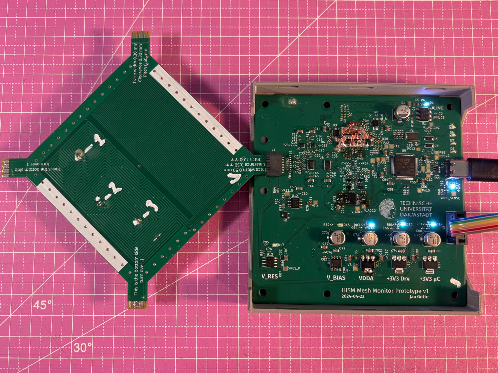

High Fidelity Security Mesh Monitoring using Low-Cost, Embedded Time Domain Reflectometry
=========================================================================================

This repository contains all sources for our paper "High Fidelity Security Mesh Monitoring using Low-Cost, Embedded Time
Domain Reflectometry" to be published in CHES 2026/1 (`preprint on eprint <https://eprint.iacr.org/2025/1962>`__). You
can find a brief overview of the project `on Jan's blog <https://jaseg.de/blog/paper-sampling-mesh-monitor/>`__.

The canonical hosting location for this repo is https://git.jaseg.de/sampling-mesh-monitor.git . For comments or
questions, please reach out to Jan via `email <mailto:research@jaseg.de>`__ or `on mastodon
<https://chaos.social/@jaseg>`__.

          board-edge connector. The first PCB looks not very complex.

    The final setup. On the right is the measurement board, and on the left is the mesh test specimen plugged in. In a
    real application, you would integrate both into your target circuit.

Paper abstract
--------------

    Security Meshes are patterns of sensing traces covering an area that are used in Hardware Security Modules (HSMs)
    and other systems to detect attempts to physically intrude into the device's protective shell. State-of-the-art
    solutions manufacture meshes in bespoke processes from carefully chosen materials, which is expensive and makes
    replication challenging. Additionally, state-of-the-art monitoring circuits sacrifice either monitoring precision or
    cost efficiency. In this paper, we present an embeddable security mesh monitoring circuit constructed from low-cost,
    standard components that utilizes Time Domain Reflectometry (TDR) to create a unique fingerprint of a mesh. Our
    approach is both low-cost and precise, and enables the use of inexpensive standard Printed Circuit Boards (PCBs) as
    security mesh material. We demonstrate a working prototype of our TDR circuit costing less than 10 € in components
    that achieves both time resolution and rise time better than 200 ps—a 25 × improvement over previous work. We
    demonstrate a simple classifier that detects several types of advanced attacks such as probing using an oscilloscope
    probe or micro-soldering attacks with no false negatives.

Repo structure
--------------

``main_pcb``
    KiCad design files, exports and manufacturing files for the main circuit board. This board contains the measurement
    circuit, and has a connector for test coupons to be inserted. Data is read out throught the SWD interface using an
    SWD adapter. The board is a 6-layer

``test_coupons``
    KiCad design files, exports and manufacturing files for the test coupon PCBs. The coupons are four-layer boards.
    Each coupon contains four test meshes, two on each side, that can be connected through four SFP form factor board
    edge connectors at the coupon's corners.

``firmware``
    Source code for the firmware as well as tooling for running the experiments. The firmware is written in C, and
    you'll need a standard ARM GCC/binutils toolchain to build it. The experiment tool is a python script that connects
    to the board through GDB and exposes a local web server for controlling the board, monitoring the measurements in
    real time, and capturing data.

``analysis``
    All raw data, as well as the Jupyter notebooks used for analysis and plotting. By running these notebooks, you can
    re-run the analysis, and re-export all plots in the paper. The raw data is contained in JSON files, one per
    measurement series. Each JSON file contains some metadata describing the experiment and the settings used during the
    experiment, a set of calibration runs with the target specimen disconnected using the board's routing switches, and
    a full set of 12 measurement arrays consisting of a mean and standard deviation for each data point. To save space,
    batches of these JSON files are aggregated into zip archives. The analysis Jupyter notebooks will automatically load
    and decode the data from these zip archives when run.

``paper``
    The source of the paper, as well as exports of all plots.

Running the analysis
--------------------

To re-run the analysis, first install `Jupyter Lab <https://jupyter.org/>`__ and the `numpy <https://numpy.org/>`__ and
`scipy <https://scipy.org/>`__ python packages. If you're running in a virtualenv or on a weird platform like Windows or
MacOS, make sure that jupyter and pip agree where your python lives and the packages get installed in the right place.

Afterwards, just run ``jupyter lab`` in the ``analysis/jupyter_notebooks`` directory. You can then open any of the
notebooks through the left side panel and re-run the analysis within. Make sure you run all of the setup code at the top
of the notebook once before trying to run the analaysis code in the cells below.

The notebooks will display the plots and results inside Jupyter Lab and will also automatically export the plots to the
``paper`` directory of your clone of the git repository.

PCB Designs
-----------

This repo includes both the raw CAD files of the PCBs, as well as exported manufacturing data for easier viewing if you
don't have KiCad installed. The schematics are included as PDF exports.

The PCB designs were prepared in the open source KiCad_ EDA tool. Note that for some files you might need to download a
KiCad nightly build depending on how new your KiCad version is.

PCB design folder structure
...........................

``foobar.{kicad_pro,kicad_sch,kicad_pcb,etc.}``
    The KiCad source files of the PCB. Open the ``.kicad_pro`` file in KiCad, then you can open the schematics and board
    layout from there.

``fab/gerbers.zip``
    Gerber exports of the board layouts. You can open these in any Gerber viewer such as gerbv_. These files are
    essentially vector graphics exports of the board layout. They show what copper, silkscreen etc. you see on the
    board, but they don't include any semantic information such as component values. You can send this zip directly to a
    PCB manufacturer and they will be able to manufacture these boards for you. The order parameters are included in the
    gerber files on the ``User.Comments`` layer.

``fab/{bom.csv,pos.csv}``
    Bill of materials and component placement coordinate files for board manufacturing. If you want a contract
    manufacturer to solder these boards for you, you need to give them these two files in addition to the gerbers. The
    BOM tells them what exact parts and how many of them you need, the position file tells them where to put them on the
    board. We had JLCPCB make the PCBs, and we also had them solder most of the parts. Some parts we soldered after the
    fact by hand because JLC didn't have them in stock, and getting them to order and solder them for us would have been
    pretty expensive.

    If you want to solder the main PCB yourself, you need some prior experience in fine SMD work and a decently setup
    electronics lab with a microscope, a hot air reworks station, etc.

    Note: **The PCB revision here does not have a functional driver IC!** For our lab experiments we microsoldered
    the four different driver ICs by hand to avoid having to spin multiple copies of this expensive PCB. For some basic
    measurements, you can just omit the driver IC included in the design and bridge it. This will drive the mesh
    directly from the ``74LVC2G157`` gates, which is enough for some basic measurements.

``schematics/*.pdf``
    PDF export of the schematics of the board.

Firmware
--------

The firmware and associated scripts are contained in the ``firmware`` directory.

Building the firmware
.....................

If you have an ARM GCC toolchain installed, you can build the firmware by running ``make`` in this directory. During
build, the makefile exports some diagnostic information about the build artifacts. For that to work, you have to have
the `cxxfilt python package <https://pypi.org/project/cxxfilt/>`__ installed. If the package can't be found, the
firmware will still be built, but you will get a crash in the makefile during the analysis step that runs after the
build was successful.

Running experiments
...................

To run an experiment, connect the board to power via USB, and to your computer through an SWD debug adapter. We used
cheap STLinkV2 clones, if you have a different adapter you'll have to modify the ``.gdbinit`` script accordingly. After
connecting the board, open three terminal windows running the following three commands one per window, in this order.

1. ``openocd -f openocd.cfg``
2. ``arm-none-eabi-gdb build/main.elf``
3. ``python adc_serve.py``

This will connect to the board and start the realtime control and measurement web interface. You can open the web
interface at the location printed by ``adc_serve.py`` on startup.

If you're cheap like us and use a STLinkV2 clone SWD adapter, it may be that openocd takes a few (maybe up to five or
so) attempts to start up and connect to the microcontroller. After starting, the GDB terminal should start printing a
few lines of output every 30 seconds or so when it saves a measurement series. If GDB starts to hang, it might be that
you bumped a cable or accidentially shorted something on the board. To re-start, you first kill gdb (Ctrl+C, then
Ctrl+D, then Ctrl+D again), then you stop openocd (Ctrl+C, kill it if it doesn't stop in a few seconds), then you
restart them in the order above. You don't have to restart the web interface, just adjust any of the knobs to overwrite
the default control settings again.

Firmware Folder Structure
.........................

``src/main.c``
    The source code of the mainboard firmware. This firmware captures data into internal buffers, which are read out
    from the host through SWD.

``openocd.cfg``
    OpenOCD script for connecting to the debug adapter. We used cheap STLinkV2 clones from aliexpress. If you use a
    different debug adapter, you will have to modify this file accordingly to tell OpenOCD how to connect to the board.
    The port numbers given here and in the ``.gdbinit`` must match up.

``.gdbinit``
    GDB script running the data extraction. This script will continuously dump the measurement data into ``/tmp`` every
    time a measurement series has been completed. Note that this file will be hidden on unixes. Also note that you will
    have to explicitly allowlist this file's absolute path on your computer in your ``$HOME/.gdbinit`` the first time
    you run it because gdb refuses to run unknown ``.gdbinit`` files for security.

``adc_serve.py``
    Real-time monitoring and data capture tool. Before running this, first make sure you have gdb attached to the board
    using the ``.gdbinit``. The tool communicates with the gdb script through files in ``/tmp``. It exposes a web
    interface that displays the captured data in real time, allows you to change the board's measurement settings, and
    allows you to export measurement series.

``make_barcodes.py``
    This is a helper script we used to create barcode labels for all ~120 test specimens to simplify the measurement
    workflow. We had a barcode reader hooked up to the computer running the measurements, so you could just scan a
    specimen's barcode to capture a data series registered to that board in the web interface.
    
other files:
    Build files for the firmware. These are mostly generic to this type of microcontroller and are included here so the
    firmware source is self-contained.

.. _KiCad: https://www.kicad.org/
.. _gerbv: https://gerbv.github.io/
